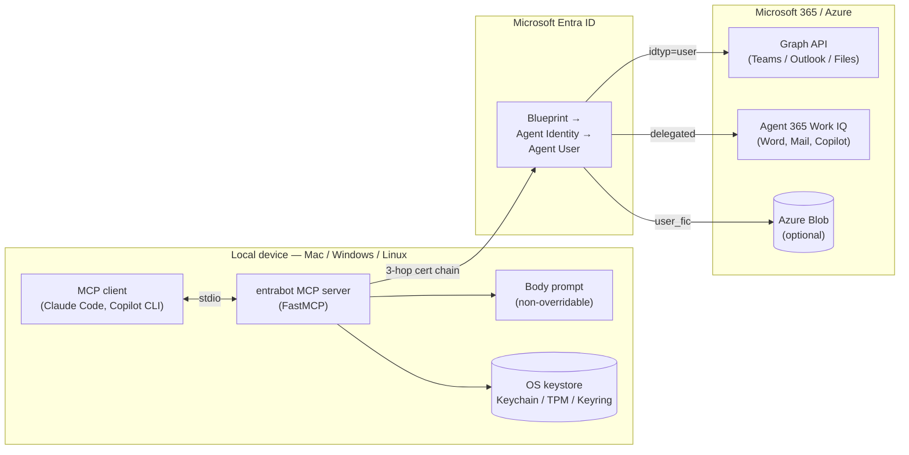

# Entrabot: Identity Research for Microsoft 365 Agents


Entrabot is a Python MCP server that gives a device-local agent its own Entra **Agent ID** and **Agent User**. The agent can sign in autonomously, send and receive Teams messages from its own account, use its mailbox, work with Microsoft 365 files, and write audit events against its own object ID. It runs on macOS, Linux, and Windows and works with Claude Code, Copilot CLI, or any MCP-speaking client.

**All you need to get started is:**

* A Microsoft 365 development tenant where you can create app registrations and grant admin consent
* A license that includes Teams and Outlook (E3 or E5 dev tenant licenses work)
* Python 3.12 installed locally

The scripts will take care of the rest: provisioning the Agent Identity Blueprint, Agent Identity, and Agent User in Entra; uploading a self-signed certificate; assigning the license; and configuring the local MCP server.

The **Microsoft Entra Agent ID** platform is generally available (Microsoft Entra, April 2026) and **Microsoft Agent 365** is generally available, licensed per user. Agents with their own user account, the Agent User Entrabot is built on, are still available only to tenants in Microsoft's [Frontier preview program](https://learn.microsoft.com/microsoft-agent-365/developer/identity) (Microsoft Learn, November 2026), so your tenant needs Frontier. Entrabot is an open-source reference implementation that pulls those primitives together on a real device.

---

## What this is

A device-local MCP server that turns an LLM agent into a first-class principal in Microsoft Entra. Three things change when you do this:

- **Attribution.** Every action — Teams message sent, file read, email drafted — is made with the agent's own token, not the token of the human who launched it. Sign-in logs distinguish them, and Entrabot's local audit log records each send, create, share and delete before it happens.
- **Authorization.** Conditional Access policies can target the agent's own user account (it needs Microsoft 365 E7, or Agent 365 with Entra ID P1), and ID Protection for agents is in preview. You can restrict what the agent can do without restricting yourself.
- **Autonomy.** No device-code prompt, no OBO, no human in the loop on every token refresh. The agent authenticates with its own certificate-backed credentials and minds its own session.

It is for developers building agents on Microsoft 365 who want the security posture to match the architecture. The agent's smarts are up to you. entrabot gives it a secure seat at the table and the keys to the kingdom; what it does with that power is your call.

The body prompt (`prompts/agent_system.md` plus `prompts/anatomy/*.md`) loads before any optional persona. Security rules, channel discipline, and external-content boundaries are enforced by the body and reinforced in code. These controls reduce instruction-injection risk; they are not an absolute guarantee against every jailbreak technique.

---

## The stack

entrabot is the device-side glue for a set of Microsoft platform primitives, some generally available and some in preview.

- **Entra Agent ID** — the four-object hierarchy: Agent Identity Blueprint → BlueprintPrincipal → Agent Identity → Agent User. Confidential clients only; no public-client flows; tokens carry `idtyp=user` for the Agent User leaf. ([platform docs](docs/platform-docs/agent-id-blueprints-and-users.md))
- **Microsoft Agent 365** — the control plane: admin-center inventory, OTel observability, Work IQ MCP servers (Mail, Calendar, Teams, SharePoint, OneDrive, Word, User, Copilot, Dataverse), AI-teammate lifecycle. Entrabot sends Agent 365 telemetry through Microsoft's OpenTelemetry Distro (`microsoft-opentelemetry`) when it is switched on; see [Telemetry and the Agent 365 registry](docs/platform-docs/microsoft-agent-365.md#telemetry-and-the-agent-365-registry). ([platform docs](docs/platform-docs/microsoft-agent-365.md))
- **Conditional Access for agents** — target the agent's user account or its Agent Identity with CA policies (Microsoft 365 E7, or Agent 365 with Entra ID P1).
- **ID Protection for agents** — preview. Risk scoring and remediation against the agent's own object.
- **FastMCP** — the Python MCP server framework. entrabot registers every Teams, Outlook, Files, Word, audit, and identity tool through it.
- **Three-hop certificate chain** — Blueprint token (cert JWT) → Agent Identity token (federated identity credential) → Agent User token (`user_fic` grant). No client secret in flight. Private key in macOS Keychain, a non-exportable Windows CNG key (held by the TPM when the TPM accepts it), or Linux Secret Service.

entrabot connects these. The Blueprint is provisioned via Graph. The Agent User is licensed and visible in Teams. The MCP server runs locally, mints tokens against Entra without a human, and exposes the resulting capability surface to the agent.

---

## Architecture



The agent talks to the MCP server over stdio. The server reads the Blueprint's private key from the OS keystore, walks the three-hop chain to produce a delegated user token, and uses that token for every Graph and Work IQ call.

**Inbound delivery differs by host.** On **Claude Code**, the server's background poll pushes every inbound Teams message and email directly into the LLM as a `notifications/claude/channel` system reminder — the agent sees a DM the moment it lands, with no tool call and no human prompt required. The conversation in Teams becomes the conversation with the agent. On **Copilot CLI, Codex, Cursor, and any MCP host that doesn't implement the channel-push extension**, the same background poll runs server-side, but messages accumulate in the interaction log instead of streaming in. The agent reads them on demand via `read_teams_messages`, `send_teams_message` auto-blocks for the sponsor's reply when push is unavailable, and `scripts/catch_up.py` prints recent activity from the CLI. Channel push is the better UX; the polling fallback is a working second-class path for hosts that haven't shipped the extension yet.

Operational state (interaction log, daily summaries, watched chats) lives locally by default, or in Azure Blob Storage scoped to the Agent User's object ID when cloud memory is enabled.

Full walkthrough in [`docs/architecture/system-overview.md`](docs/architecture/system-overview.md). The module-by-module breakdown lives in [`docs/architecture/layers/`](docs/architecture/layers).

---

## Quickstart

### Windows

Download the latest release (the source code ZIP on <https://github.com/microsoft/entrabot/releases/latest>) or clone it, then double-click `scripts\setup-windows.cmd`. Or from a terminal:

```bat
git clone --branch v0.2.0 https://github.com/microsoft/entrabot.git
cd entrabot
scripts\setup-windows.cmd
```

Nothing needs installing first: no PowerShell 7, Python, Azure CLI, `winget`, or administrator rights on the PC. Setup asks a few questions (each has a suggested answer), signs you in to Microsoft, creates the agent, and tests it. When it finishes, double-click `start-entrabot.cmd` to start the agent.

What you need: a Microsoft 365 tenant, an account that administers it, and a free licence that includes Teams. To skip the questions, pass the answers: `scripts\setup-windows.cmd -NewChain -UpnSuffix workstation -Yes`. Guide, limits, and what has and has not been tested: [`docs/getting-started/windows.md`](docs/getting-started/windows.md).

### macOS or Linux

```bash
git clone --branch v0.2.0 https://github.com/microsoft/entrabot.git
cd entrabot
./scripts/setup.sh
./start-entrabot.sh
```

This clones the latest release, v0.2.0. `main` is development and may be ahead of it. Git then prints a note about a "detached HEAD": that is normal when you check out a release tag, not an error. To upgrade an existing install, see [Upgrading to a new release](docs/troubleshooting/migrations-and-upgrades.md#upgrading-to-a-new-release).

Setup needs Python 3.12 or newer and nothing else first: no Azure CLI and no `az login`. It runs the same setup wizard as Windows: it asks a few questions (each has a suggested answer), signs you in to Microsoft, creates the agent, keeps its sign-in key in your Keychain or keyring, and tests it. To skip the questions, pass the answers: `./scripts/setup.sh --new --with-upn-suffix=workstation --yes`. On Ubuntu 24.04 the wizard has been run end to end against a real tenant; on macOS only a repair run and the health check have. Guide, limits, and what has and has not been tested: [`docs/getting-started/macos-linux.md`](docs/getting-started/macos-linux.md).

Setup is idempotent on every platform. It provisions the Blueprint, BlueprintPrincipal, Agent Identity, and Agent User; assigns a Teams-capable license; uploads a self-signed certificate to Entra; and writes `.env` plus `.mcp.json` with no secrets on disk. Full walkthrough — including cloud memory, cross-tenant group chats, and the Work IQ Word setup — is in [`docs/getting-started/quickstart.md`](docs/getting-started/quickstart.md) and [`INSTALL.md`](INSTALL.md).

### Launching the agent

The repo isn't published to npm/pypi — your host CLI loads the local stdio MCP server from `.mcp.json` in the cwd. No flag needed for that; it's auto-discovered. What differs between hosts is **how inbound Teams DMs reach the agent**.

**Claude Code (recommended).** Channel push: inbound Teams messages and emails arrive as next-turn system reminders without a tool call. Requires the dev-channel allowlist flag:

```bash
claude --dangerously-load-development-channels server:entrabot
```

`./start-entrabot.sh` (macOS and Linux) and `start-entrabot.cmd` (Windows) run this command for you. Claude Code on Windows also needs Git for Windows for this repo's hooks; setup offers to install both there. On macOS and Linux, setup does not install Claude Code.

The double-dash matters — single-dash silently treats `server:entrabot` as prompt text (Learning #44). `server:entrabot` is the MCP server name from `.mcp.json`, not a publication identifier.

**GitHub Copilot CLI, Codex, Cursor, other non-Claude hosts.** MCP tools work, but there's no `notifications/claude/channel` equivalent — channel push is silently absent. Inbound Teams messages instead arrive **inline** as `sponsor_reply` on `send_teams_message`, which auto-blocks until the sponsor replies (host-detected, server-side).

```bash
copilot   # or: codex, cursor, etc. — no flag, just launch from the repo dir
```

While the agent is blocked waiting on a Teams reply (any host that calls `wait_for_sponsor_dm` explicitly), the host CLI shows a heartbeat animation so you know it's listening to Teams, not your keyboard:

```
           __
      (___()'`;  woof! 🐕
      /,    /`
      \"--\

(•ᴗ•) zZz... listening for Teams DM [42s] (Ctrl+C to break)
```

Frames cycle (`ʕ•ᴥ•ʔ waiting on sponsor`, `(´･ω･`) sponsor hasn't replied yet`, `(◕‿◕) still here, still waiting`, …) every ~30s with elapsed time. Ctrl+C breaks out cleanly. Full host-by-host protocol: [`docs/clients/overview.md#sponsor-dm-wait-pattern`](docs/clients/overview.md#sponsor-dm-wait-pattern) and [`prompts/anatomy/channel-discipline.md`](prompts/anatomy/channel-discipline.md).

After setup, use `./status.sh` as the canonical health and identity check:

```bash
./status.sh
./status.sh --health-only --strict
./scripts/setup.sh --status --json   # delegates to ./status.sh
./scripts/setup.sh --diagnose        # setup's own health check; changes nothing
```

On Windows:

```bat
scripts\setup-windows.cmd -Diagnose
powershell -ExecutionPolicy Bypass -File status-windows.ps1 -HealthOnly -Strict
```

---

## Documentation

The full doc site: **<https://microsoft.github.io/entrabot/>**

Direct pointers:

- [Quickstart](docs/getting-started/quickstart.md) — from clone to first Teams message
- [MCP tool reference](docs/reference/mcp-tools.md) — every tool, every parameter
- [Setup script reference](docs/reference/scripts/setup/setup-sh.md) — `setup.sh` options and behavior
- [Script reference](docs/reference/scripts/index.md) — status, health, DM, email, setup, teardown, and diagnostic scripts
- [Token flows](docs/reference/token-flows.md) — the three hops, annotated
- [System overview](docs/architecture/system-overview.md) — how the modules fit together
- [Platform docs](docs/platform-docs/) — Entra Agent ID constraints, Agent 365, delegated auth, OS-specific notes
- [Troubleshooting](docs/troubleshooting/index.md) — symptom-first guide to common setup, auth, and runtime failures
- [Current status](docs/project/status.md) — what's shipped, what's open, what's next
- [Changelog](CHANGELOG.md) — release history

---

## Status

This is a research repo, not a production service. It runs reliably on a developer's machine. It is not packaged for tenant-wide deployment.

**Shipped:**

- Two authenticated session types: `agent_user` (full three-hop), `delegated` (MSAL interactive for demos or environments without a provisioned Agent User)
- Teams: 1:1 DMs, group chats, cross-tenant B2B chats with federated home-tenant resolution
- Outlook: background email poll, Purview-encrypted detection, and a daily summary scheduler that mails the agent's directory sponsors
- Files: SharePoint / OneDrive read, write, upload, share — three-stage sponsor authorization on share (sponsor allowlist, active-channel binding, Graph chat membership)
- Microsoft Agent 365 Work IQ Word: create, read, comment, reply-to-comment
- Storage: `LocalBackend` (default) and `BlobBackend` (Azure Blob Storage, opt-in via `setup.sh --use-cloud-memory` or the Windows setup wizard)
- Body-first prompt architecture with optional persona layer from a separate MCP (`persona-sati`)
- Audit before acting: every tool that sends, creates, shares or deletes writes its audit event first (to a local JSONL file, flushed to disk) and does nothing if that write fails. Teams and mail reads are not audited. Events the model writes through `audit_log` are marked as the model's
- Outbound recipient policy, enforced in the server: the agent may reach its sponsors, the members of the chat a request came from, and its own tenant; anyone else needs `ENTRABOT_OUTBOUND_ALLOW`
- Agent 365 integration (opt-in in setup, one question): the agent's entry in the Agent 365 registry, so it is listed in the Microsoft 365 admin center (on `main`; run for real on Linux so far), and Agent 365 telemetry: content-suppressed spans from the MCP server and from the harness (`entrabot`, an optional terminal front end on the GitHub Copilot SDK that runs the model loop itself). Agent 365 keeps them only if the tenant has a Microsoft 365 E7 or Agent 365 licence assigned
- `pytest -v --tb=short && ruff check .` gates every commit

**Persona-sati host bootstrap:** Hosts that attach persona-sati must call `bootstrap_session` before the first substantive answer because FastMCP instructions do not reliably reach the LLM prompt. If `mind_contract_available` is false, operate in body-only mode. When the mind contract is available, follow the per-turn cognition tools: `observe` around external tools, `reflect` for durable observations, and `recall` when a returned memory excerpt is insufficient.

**OS coverage:**

| OS | Status |
|---|---|
| macOS | The same setup wizard as Windows, with one Keychain item per certificate (the certificate and its key), certificate rotation, and teardown that disconnects this computer. Against a real tenant only a repair run and the health check have been run; a new agent, rotation and teardown are covered by unit and script tests. See [macOS and Linux installation](docs/getting-started/macos-linux.md#what-has-been-tested). |
| Linux | The same wizard and runtime, with the key in a Secret Service, KWallet or libsecret keyring that is running and unlocked. Run end to end on Ubuntu 24.04.5 against a real tenant (new agent, rotation, joining, teardown). |
| Windows | Shipped — one-step setup wizard, non-exportable CNG keys (TPM first, software key store otherwise), certificate rotation, teardown. Setup, repair, rotation, status and teardown were run end to end on Windows 11 25H2 x64 with a virtual TPM, as a non-administrator. Not yet tested: ARM64, physical TPMs, Windows 10, Entra-joined or Intune-managed PCs. See [Windows installation](docs/getting-started/windows.md#what-has-been-tested). |

**Open:**

- Process containment is not shipped: the MCP server is not contained in 0.2.0 and runs with all of its user's rights. Containing it on macOS and Linux is planned for 0.3.0.
- Registration in the Agent 365 registry through setup has not yet been run against a tenant.
- Headless and cloud operation: see the proposal in `engineering-history/plans/headless-cloud-runtime.md`.

---

## Contributing, support, and license

- [Contributing](CONTRIBUTING.md)
- [Code of conduct](CODE_OF_CONDUCT.md)
- [Support](SUPPORT.md)
- [Security reporting](SECURITY.md)
- [MIT License](LICENSE)

This is a prototype. It is designed to show the pattern and make the implementation copyable, not to be run unchanged as a production platform.